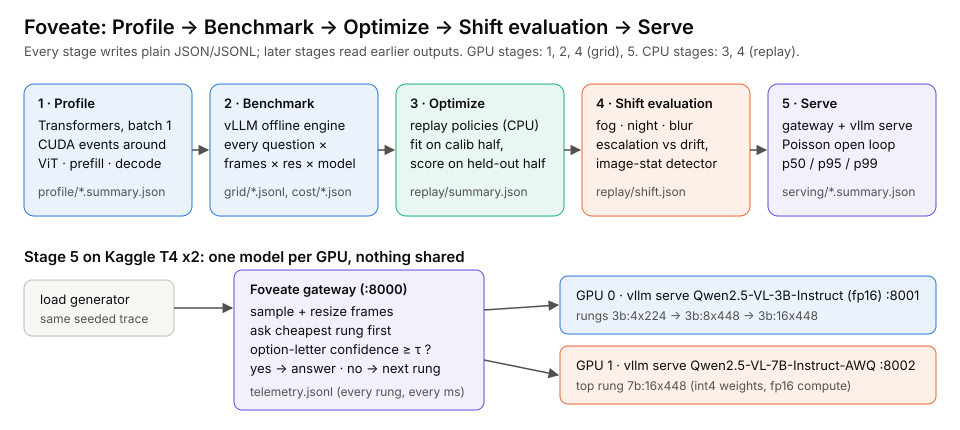
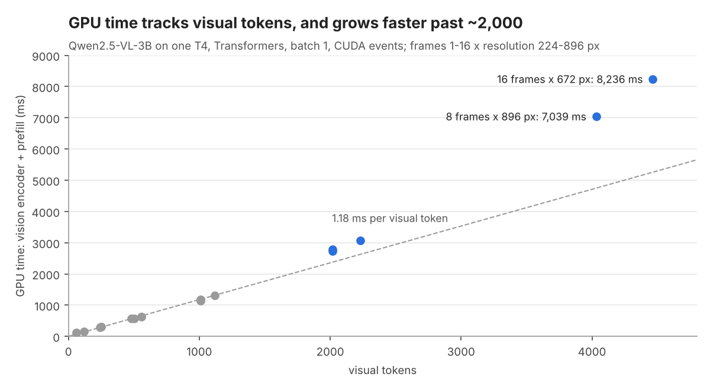
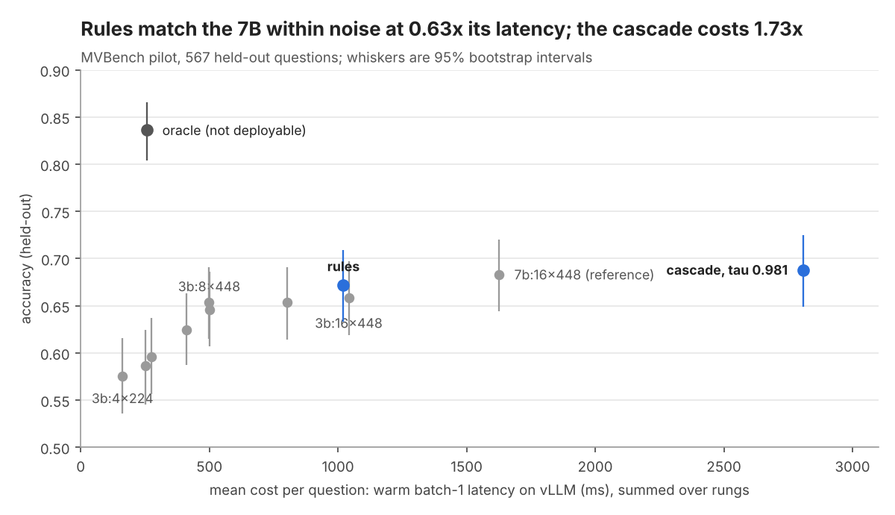
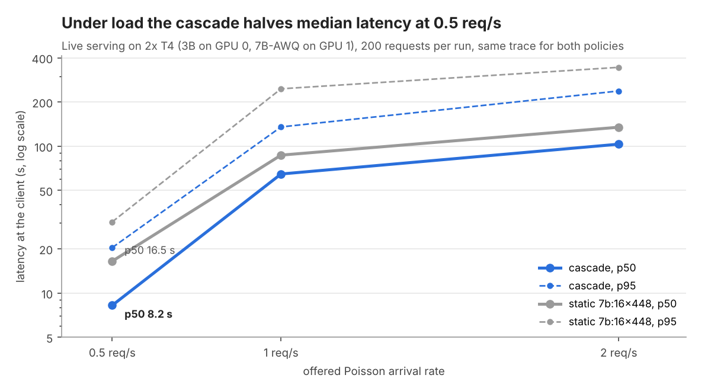

# Foveate: Adaptive Inference for Vision-Language Models

**An open-source harness for profiling, benchmarking and adaptive inference of video
vision-language models (VLMs), built for and measured on Kaggle's free 2x T4 GPUs.**

[](https://github.com/Vivvek09/Foveate-Adaptive-Inference-for-Vision-Language-Models/actions/workflows/ci.yml)

**Contents:** [The idea](#the-idea) · [Results](#results) · [Quick start](#quick-start) ·
[Pipeline](#the-pipeline) · [Modes](#three-modes) · [Kaggle T4 notes](#kaggle-t4-x2-notes) ·
[What is verified](#what-is-verified) · [Repository layout](#repository-layout) ·
[Troubleshooting](#troubleshooting) · [Limitations](#limitations) · [Licences](#licences)

---

## The idea

A video VLM's cost is dominated by **visual tokens**. For Qwen2.5-VL the count is
`ceil(frames/2) × (res/28)²`, so two knobs (frames and resolution) plus the model size set
most of the bill. Most deployments pick one setting for every request: easy questions then
pay for pixels they don't need, and hard ones may still not get enough.

Foveate asks whether a policy can spend compute **per request** instead. It:

1. **Profiles** where the time goes (frame decoding, vision encoder, prefill, decode) with
   CUDA events.
2. **Caches a quality grid**: every benchmark question under every (frames, resolution,
   model) setting on vLLM, with the answer's confidence.
3. **Replays policies offline**: fixed settings, learned per-task rules, and a confidence
   cascade that answers cheaply first and escalates only when unsure. Thresholds are fit on
   one half of the questions and reported on the other, with paired bootstrap intervals and
   a non-deployable oracle as the ceiling.
4. **Tests distribution shift**: fog, night and blur corruptions, and a model-free drift
   detector.
5. **Serves** the policy behind a gateway in front of two `vllm serve` processes, one per
   GPU, under open-loop Poisson load.

It is a harness for *investigating* adaptive compute, not a claim that it is solved: whether
a cascade wins depends on how well the model's confidence separates right answers from
wrong ones, and the report says so either way.



## Results

First full run: **Kaggle 2x NVIDIA T4, vLLM 0.32.0, Qwen2.5-VL-3B (fp16) and
Qwen2.5-VL-7B-AWQ, MVBench pilot, October 19 2026.** Every number below is copied from that
run's generated report and serving summaries into
[`docs/results/pilot_2026-10-19.json`](docs/results/pilot_2026-10-19.json), and the figures
are drawn from that file by [`tools/make_readme_figures.py`](tools/make_readme_figures.py).
This is a pilot (30% of MVBench), so treat differences inside the confidence intervals as
ties.

### 1. GPU time follows visual tokens



Up to about 1,000 visual tokens, vision encoder plus prefill costs a roughly constant
~1.2 ms per token on the 3B model. Past ~2,000 tokens prefill grows faster than linearly:
16 frames at 672 px (4,464 tokens) takes about 8.2 s of GPU time, against 0.6 s for
16 frames at 224 px. Frames 1 and 2 cost the same because Qwen2.5-VL merges frame pairs.

### 2. Accuracy against cost (held-out MVBench questions)



| Policy | Accuracy (95% CI) | Mean cost | vs reference |
|---|---|---|---|
| Fixed cheapest, `3b:4x224` | 0.575 (0.536–0.616) | 163 ms | 0.10x |
| Static intermediate, `3b:16x448` | 0.658 (0.619–0.697) | 1,042 ms | 0.64x |
| **Fixed strongest (reference), `7b:16x448`** | **0.683 (0.644–0.720)** | **1,625 ms** | **1.00x** |
| **Learned per-task rules** | **0.672 (0.633–0.709)** | **1,021 ms** | **0.63x** |
| Confidence cascade (τ = 0.981) | 0.688 (0.649–0.725) | 2,809 ms | 1.73x |
| Oracle (not deployable) | 0.836 (0.804–0.866) | 257 ms | 0.16x |

1,135 pilot questions over 19 tasks; τ and the rules were fit on 568 and scored on the
other 567. Cost is warm batch-1 latency on vLLM, and a cascade pays for every rung it runs.

- **Rules** (one setting per task family) match the 7B within noise at 0.63x its latency.
- **The cascade** escalated 93% of questions, so it paid for the cheap attempts and then
  the expensive one. Offline it is the most expensive policy.
- **The oracle gap** (0.836 vs 0.683) shows that a cheap setting is often right when the
  expensive one is wrong; the hard part is knowing in advance which questions those are.

### 3. Why the cascade escalates so often: calibration

| Setting | Accuracy | AUROC (confidence vs correct) | ECE |
|---|---|---|---|
| `3b:4x224` | 0.575 | 0.707 | 0.074 |
| `3b:8x448` | 0.654 | 0.785 | 0.049 |
| `3b:16x448` | 0.658 | 0.798 | 0.063 |
| `7b:8x448` | 0.654 | 0.715 | 0.225 |
| `7b:16x448` | 0.683 | 0.725 | 0.197 |

The 3B models are well calibrated (ECE 0.05–0.09) but their confidence only moderately
separates right from wrong answers, so a threshold that protects accuracy has to escalate
most questions. The 7B-AWQ model is markedly overconfident (ECE about 0.2).

### 4. Distribution shift (severity 3)

| Corruption | Cascade accuracy, clean → shifted | Escalation, clean → shifted | Cheap-rung AUROC, clean → shifted | Drift alarm after |
|---|---|---|---|---|
| Blur | 0.671 → 0.609 | 92.8% → 97.0% | 0.714 → 0.656 | no alarm |
| Fog | 0.671 → 0.655 | 92.8% → 95.6% | 0.714 → 0.707 | 39 requests |
| Night | 0.671 → 0.602 | 92.8% → 98.9% | 0.714 → 0.658 | 17 requests |

The cascade does spend more on harder inputs, but accuracy still drops. The image-statistics
detector caught fog and night with no false alarms on clean data, and missed blur.

### 5. Live serving under load



| Offered rate | Policy | p50 | p95 | Throughput | Accuracy |
|---|---|---|---|---|---|
| 0.5 req/s | **cascade** | **8.2 s** | **20.4 s** | 0.43 req/s | 0.685 |
| 0.5 req/s | static `7b:16x448` | 16.5 s | 30.5 s | 0.43 req/s | 0.685 |
| 1 req/s | cascade | 64.6 s | 135.2 s | 0.54 req/s | 0.685 |
| 1 req/s | static `7b:16x448` | 86.9 s | 245.9 s | 0.42 req/s | 0.685 |
| 2 req/s | cascade | 103.2 s | 237.7 s | 0.54 req/s | 0.685 |
| 2 req/s | static `7b:16x448` | 134.6 s | 344.4 s | 0.42 req/s | 0.685 |

3B fp16 on GPU 0 and 7B-AWQ on GPU 1 behind the Foveate gateway; 200 seeded Poisson
requests per run, the same trace for both policies; 200 of 200 requests succeeded in every
run. Offline the cascade costs more, yet under load it halves median latency at 0.5 req/s
and sustains about 30% more throughput. Our reading: the static policy leaves GPU 0 idle
and queues everything on GPU 1, while the cascade puts both GPUs to work. Above
~0.5 req/s both setups are past capacity on two T4s and latency is queueing.

## Quick start

On any CUDA machine (on Kaggle, use the notebook in the next section):

```bash
git clone https://github.com/Vivvek09/Foveate-Adaptive-Inference-for-Vision-Language-Models foveate
cd foveate
bash scripts/setup_gpu.sh                 # vLLM build matched to the driver, then foveate
foveate smoke --models 3b 7b --profile    # 8 generated questions; every stage checked
cat results/smoke/SMOKE.md                # PASS / WARN / FAIL per check
```

### On Kaggle

Open [`notebooks/foveate_kaggle.ipynb`](notebooks/foveate_kaggle.ipynb) on Kaggle with
*GPU T4 x2* and *Internet on*. Keep `MODE = "smoke"` for the first run, then switch to
`"pilot"` or `"full"`. The notebook embeds this exact package revision (CI fails if it is
stale), so it needs nothing else.

### Whole pipeline from the repo

`MODE=smoke|pilot|full GPUS=2 bash scripts/run_all.sh`, or stage by stage:

```bash
foveate profile --model 3b --source synthetic                 # 1 Profile (no dataset needed)
foveate download mvbench --tasks all                          # ~17 GB; --tasks lite skips 11 GB
foveate grid  --dataset mvbench --pilot --model 3b --gpus 2   # 2 Benchmark (one process per GPU)
foveate grid  --dataset mvbench --pilot --model 7b --gpus 2
foveate shift --dataset mvbench --pilot --model 3b --gpus 2   # 4 shifted copies
foveate shift --dataset mvbench --pilot --model 7b --gpus 2
foveate replay --dataset mvbench --pilot                      # 3 + 4 policies and shift (CPU)
MODE=pilot bash scripts/serve_and_load.sh                     # 5 Serve: vLLM x2 + gateway + load
foveate report                                                # results/REPORT.md + figures/
```

Data goes to `./data` (`FOVEATE_DATA`), results to `./results` (`FOVEATE_RESULTS`), and the
decoded-frame cache to `data/frame_cache` (`FOVEATE_CACHE`).

## The pipeline

| # | Experiment | Stage | What is measured |
|---|---|---|---|
| E0 | Smoke test | all | model load, video decode, token count = formula, finite letter probs, storage, one profile setting |
| E1 | Latency anatomy | 1 Profile | load / preprocess / vision encoder / prefill / decode vs frames × res (1–16 × 224–896), decode sweep, cold vs warm |
| E2 | Quality grid | 2 Benchmark | MVBench (19 tasks) accuracy, confidence and latency for 7 × 3B and 2 × 7B-AWQ settings |
| E3 | Adaptive policies | 3 Optimize | held-out accuracy vs cost for 3 baselines, rules, cascade, rules+cascade, oracle; what escalation fixed, broke, and the overconfident failures |
| E4 | Shift | 4 Shift | fog / night / blur escalation rate and accuracy; drift-alarm delay; drift-aware start rung |
| E5 | Serving | 5 Serve | cascade vs best static setting under the same Poisson traces at 0.5 / 1 / 2 req/s: p50/p95/p99, throughput |
| E6 | Driving demo | 2–3 | LingoQA (free-form, Lingo-Judge) through the same pipeline |

E0–E5 have run on the MVBench pilot ([Results](#results)). E6 is implemented but not yet
reported; its download can be rate-limited.

**What each stage does**

1. **Stage-level profiler.** CUDA events bracket the vision encoder, prefill and each decode
   step in Transformers. It reports warm medians and p95, a separate cold first call, and
   achieved TFLOP/s and MFU against the GPU's spec sheet.
2. **Cached quality grid on vLLM.** Every question runs through every setting once. Answers
   are scored from option-letter log-probs, with confidence, margin and entropy stored per
   row. Runs are sharded across GPUs and resumable.
3. **Policy replay with honest baselines.** Fixed cheapest, static intermediate and fixed
   strongest are compared with learned rules, a confidence cascade, rules+cascade and an
   oracle labelled non-deployable, all on held-out questions.
4. **Distribution-shift study.** Synthetic corruptions test whether the cascade spends more
   on harder inputs and whether a model-free drift detector helps.
5. **Policy-aware serving.** A FastAPI gateway in front of one `vllm serve` per GPU verifies
   its own routing, and the load generator replays identical seeded traces per policy.

Settings are written `MODEL:FRAMESxRES`, for example `3b:8x448`. Edit
`src/foveate/configs/default.yaml` or pass `--config my.yaml`.

## Three modes

| Mode | Questions | Settings | Purpose |
|---|---|---|---|
| `--smoke` | 8 (round-robin over tasks) | 1–2 per model (`smoke:` in the config) | prove the GPU stack works end to end |
| `--pilot` (default) | fixed-seed 30%, stratified by task | full grid | fast, comparable experiments |
| `--full` | all | full grid | final numbers; resumable across sessions |

Every command that touches data takes `--smoke`, `--pilot` or `--full`, and results go to
`results/<dataset>_<mode>/`. [docs/MODES.md](docs/MODES.md) lists the exact files each mode
writes and what a healthy run looks like.

## Kaggle T4 x2 notes

- **Precision.** The T4 (compute capability 7.5) has no bf16, so `--dtype auto` resolves to
  float16. An explicit `--dtype bfloat16` on a T4 is an error, not a silent emulation. AWQ
  always computes in fp16. The dtype used is recorded in every cost file.
- **Numerical stability.** fp16 overflow shows up as NaN confidences or one constant answer.
  The grid and the smoke test check for both. The fallback is `--dtype float32 --tp 2`
  (3B only, spanning both T4s).
- **Placement.** One process per GPU (`CUDA_VISIBLE_DEVICES`); the two 16 GB cards are
  separate memory pools. The 3B model is ~7 GiB of fp16 weights and the 7B-AWQ about
  6.6 GiB (int4 LLM, fp16 vision encoder and embeddings).
- **Memory-fit guard.** Before loading, each setting gets an estimate of weights + KV for one
  full `max_model_len` sequence + activations + overhead, plus an exact context-length check.
  Settings that don't fit are written to `results/<run>/skipped.jsonl` with the reason and
  are never swapped for another setting. For example, the unquantized 7B (15 GiB) and
  16 frames at 896 px (over 8,192 tokens) are skipped. The estimate is a guard, not a
  measurement.
- **Engines.** `setup_gpu.sh` picks the vLLM build from the driver's CUDA version (override
  with `VLLM_OVERRIDE`). If vLLM fails to start, `--backend auto` falls back to
  Transformers. Those rows are labelled `backend=hf`, the event is logged in
  `events.jsonl`, and a grid file never mixes backends.

## What is verified

| Layer | How | Status |
|---|---|---|
| Token math, stats, data selection, corruptions, memory guard, dtype rules | unit tests | ✅ CPU |
| Transformers backend: processor → Qwen2.5-VL forward → CUDA-event hooks → letter log-probs | tiny random Qwen2.5-VL in tests; real 3B profile on T4 | ✅ CPU and GPU |
| vLLM offline engine with real Qwen2.5-VL-3B and 7B-AWQ, T4 fp16 numerics | `foveate smoke` and the MVBench pilot on Kaggle 2x T4 | ✅ GPU (Oct 2026) |
| Grid → replay → shift → report | stand-in model in tests; MVBench pilot on GPU | ✅ CPU and GPU |
| Gateway cascade, routing check, load generator against real `vllm serve` | fake OpenAI-compatible server in tests; 6 load runs × 200 requests on GPU | ✅ CPU and GPU |
| Full MVBench (not pilot), LingoQA, other GPUs or model families | — | ❌ not run |

`pytest -q` runs 38 tests in CI on Python 3.11 and 3.12. Rows produced by the test stand-in
model are marked MOCKED, and the smoke checker rejects mocked timings.

## Repository layout

```
src/foveate/
  tokens.py            visual-token, FLOP, weight and KV-cache arithmetic (+ GPU spec table)
  memory.py            per-GPU memory-fit guard; skipped settings with reasons
  data/                MVBench, LingoQA, synthetic (MP4) loaders; frame sampling/cache; corruptions
  backends/            hf_backend.py (stage timing via CUDA events), vllm_backend.py (fast path)
  profile.py  Stage 1   grid.py   Stage 2 (sharded, resumable)   policy.py  Stage 3
  drift.py    Stage 4   serve/    Stage 5 gateway + Poisson load generator
  smoke.py             `foveate smoke` end-to-end checker      report.py  figures + REPORT.md
  configs/default.yaml models, grids, smoke settings, ladder, shift and profile settings
docs/
  architecture.svg     pipeline diagram
  MODES.md             files and healthy-run checks per mode
  results/             summary numbers from the October 2026 GPU run
  figures/             README figures (drawn by tools/make_readme_figures.py)
scripts/               GPU setup, run-all, serve-and-load, serving check
notebooks/             self-contained Kaggle notebook (built by tools/build_notebook.py)
tools/                 notebook builder, README figure script
tests/                 CPU tests (tiny random Qwen2.5-VL, fake model, fake vLLM server)
```

## Troubleshooting

- **Smoke test FAILs.** Read `results/smoke/SMOKE.md`, then `results/smoke/grid_<model>.log`.
- **vLLM will not install or start.** Try `VLLM_OVERRIDE="vllm==0.11.0" bash scripts/setup_gpu.sh`.
  Without vLLM, `--backend hf` runs the 3B grid (batch 1). Its accuracy is comparable; its
  timings aren't.
- **Every serving request fails with HTTP 400.** Recent vLLM rejects per-request
  multimodal settings unless the server is started with `--trust-request-mm-kwargs`.
  `scripts/serve_and_load.sh` passes it; add it if you launch `vllm serve` yourself.
  `scripts/serve_check.sh` starts only the 3B server with the same flags and sends one
  gateway-style request plus variants, as a quick diagnosis.
- **NaN confidences or one repeated answer.** fp16 overflow: `--dtype float32 --tp 2` (3B).
- **Out of memory at start-up.** `--enforce-eager` and/or `--gpu-mem 0.85`; check `skipped.jsonl`.
- **LingoQA download fails.** Google Drive rate-limits shared folders. Download the
  evaluation folder from the [LingoQA repo](https://github.com/wayveai/lingoqa) into
  `data/lingoqa/` manually.
- **Disk.** MVBench needs ~17 GB after extraction; `--tasks lite` needs ~6 GB.

## Limitations

- **Pilot scale.** The results use 30% of MVBench (567 held-out questions), so intervals are
  about ±4 points. Several policy differences are within noise.
- **One model family, one GPU type.** Qwen2.5-VL 3B and 7B-AWQ on T4s. The 7B is
  quantized, which may contribute to its overconfidence.
- **Low frame counts.** MVBench accuracy at 4–16 frames sits below Qwen's published scores,
  which used many more frames. The comparison that matters is between policies on the same
  questions.
- **Offline costs are sums.** Stage 3 cascade costs add measured per-setting latencies;
  stage 5 measures the real thing under load, and the two disagree for the reason given in
  [Results](#5-live-serving-under-load).
- **Synthetic corruptions** are a robustness probe, not evidence about real driving footage.
- **Skipped task.** One NTU-based MVBench task (`fine_grained_pose`) is not redistributable.
- **Prior work.** Cascades, routing and adaptive frame selection all have prior work. The
  contribution here is a measured, held-out cost/accuracy trade-off on a real serving stack,
  reported whether or not the cascade wins.
- **Not production-validated.** This is a research harness. The serving path ran 1,200
  requests on Kaggle, which is not production-level validation.

## Licences

Code: MIT. MVBench is distributed under MIT on the Hugging Face Hub (its source videos keep
their original licences). LingoQA has its own licence. Model weights follow the Qwen
licences.
